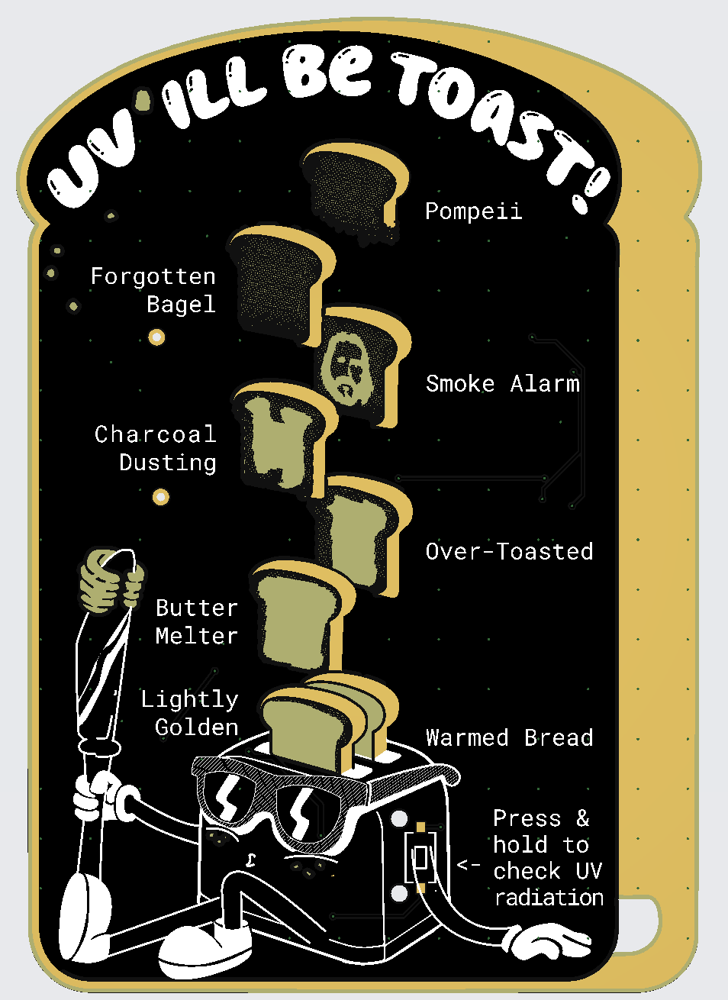

# UV_badge

<p align="center"></p>

A wearable badge that measures UV light and shows the level on a bar of
8 LEDs (red, orange, yellow). It runs on a CR2032 coin cell.

Badge artwork and design by [bingmachine](https://www.instagram.com/bingmachine/),
partner on this project.

## How it works

The schematic (`PCB/UV_badge.kicad_sch`) has three sub-sheets:

- **Power supply** (`power_supply.kicad_sch`): an MT3608 boost converter raises
  the coin-cell voltage to 5.0 V (Vout = 0.6 V × (1 + R19/R20)).
- **UV sensor + amplification** (`uv_sensor_amp.kicad_sch`): a GUVA-S12SD UV
  photodiode feeds an LMV321 op-amp.
- **LED controller** (`led_controller.kicad_sch`): two LM339 quad comparators
  compare the amplified signal against a ladder of reference voltages and
  light the LEDs as a bar graph.

## Repository layout

| Path                     | Contents                                              |
|--------------------------|-------------------------------------------------------|
| `PCB/`                   | KiCad project (schematic, PCB, project settings)      |
| `PCB/libs/`              | Local symbols, footprints and 3D models               |
| `PCB/gerbers/`           | Fabrication output                                    |
| `svg/`                   | Board artwork (copper, mask, silkscreen, edge cut)    |
| `images/`                | Pictures for this README                              |
| `datasheets/`            | Component datasheets                                  |
| `scripts/make_bom.py`    | Generates the bill of materials                       |
| `BOM.md`                 | Bill of materials                                     |

## Bill of materials

The table below (and `BOM.md`) is generated from the schematic. The `Qty x50`
column is the quantity needed for a batch of 50 PCBs. To regenerate after
changing the schematic:

```sh
python3 scripts/make_bom.py
```

This needs `kicad-cli` on your PATH (or set `KICAD_CLI`). Don't edit the table
by hand: change the part's `Description` or `link` field in the schematic and
regenerate. The batch size is set by `BATCH` in the script.

<!-- BOM:START -->
| Ref                             | Qty | Qty x50 | Value         | MPN                | Footprint                                   | Description                                                            | Link                                                                                               |
|---------------------------------|-----|---------|---------------|--------------------|---------------------------------------------|------------------------------------------------------------------------|----------------------------------------------------------------------------------------------------|
| BT1                             | 1   | 50      | Battery_Cell  |                    | C964829_BAT-SMD_MY-2032-05-R                | Single-cell battery                                                    |                                                                                                    |
| C1                              | 1   | 50      | 220uF         |                    | CP_Elec_6.3x5.4                             |                                                                        | https://www.tme.eu/de/details/vs0j221me054000ce0/elektrolytische-kondensatoren-smd/chang/          |
| C2,C4                           | 2   | 100     | 10uF          | LMK212 BJ106KG-T   | C_0805_2012Metric                           | Unpolarized capacitor                                                  | https://www.tme.eu/de/details/lmk212bj106kg-t/kondensatoren-mlcc-smd/taiyo-yuden/lmk212-bj106kg-t/ |
| C3                              | 1   | 50      | 1n            | C0805C102J5GACTU   | C_0805_2012Metric                           | Unpolarized capacitor                                                  | https://www.tme.eu/de/details/c0805c102j5gac/kondensatoren-mlcc-smd/kemet/c0805c102j5gactu/        |
| C5,C6,C7                        | 3   | 150     | 100n          | CL21B104KBFNNNE    | C_0805_2012Metric                           | Unpolarized capacitor                                                  | https://www.tme.eu/de/details/cl21b104kbfnnne/kondensatoren-mlcc-smd/samsung/                      |
| D1,D2,D3                        | 3   | 150     | KPA-3010SURCK |                    | LED_Kingbright_KPA-3010_3x2x1mm             | red                                                                    | https://www.tme.eu/de/details/kpa-3010surck/led-dioden-smd-bunt/kingbright-electronic/             |
| D4,D5,D6                        | 3   | 150     | KPA-3010SECK  |                    | LED_Kingbright_KPA-3010_3x2x1mm             | orange                                                                 | https://www.tme.eu/de/details/kpa-3010seck/led-dioden-smd-bunt/kingbright-electronic/              |
| D7,D8                           | 2   | 100     | KPA-3010SYCK  |                    | LED_Kingbright_KPA-3010_3x2x1mm             | yellow                                                                 | https://www.tme.eu/de/details/kpa-3010syck/led-dioden-smd-bunt/kingbright-electronic/              |
| D9                              | 1   | 50      | GUVA_S12      |                    | GUVA-S12SD                                  | Photodiode, filled shape                                               |                                                                                                    |
| D12                             | 1   | 50      | D_Schottky    |                    | D_SMA                                       | Schottky diode                                                         | https://www.tme.eu/de/details/ss14-dc/schottkydioden-smd/dc-components/ss14/                       |
| L1                              | 1   | 50      | 22uH          | DJNR6028-220-S     | L_Bourns-SRN6028                            | Inductor 22uH 1.3A 135mΩ, Ferrocore DJNR6028-220-S                     | https://www.tme.eu/de/details/djnr6028-220-s/drosseln/ferrocore/                                   |
| R1                              | 1   | 50      | 6.8M          | CRCW08056M80FKTABC | R_0805_2012Metric_Pad1.20x1.40mm_HandSolder | Resistor                                                               | https://www.tme.eu/de/details/crcw08056m80fktabc/smd-widerstaende/vishay/                          |
| R2                              | 1   | 50      | 20k           | RC0805FR-0720KL    | R_0805_2012Metric_Pad1.20x1.40mm_HandSolder | Resistor                                                               | https://www.tme.eu/de/details/rc0805fr-0720k/smd-widerstaende/yageo/rc0805fr-0720kl/               |
| R3                              | 1   | 50      | 4.7k          | RC0805FR-074K7L    | R_0805_2012Metric_Pad1.20x1.40mm_HandSolder | Resistor                                                               | https://www.tme.eu/de/details/rc0805fr-074k7/smd-widerstaende/yageo/rc0805fr-074k7l/               |
| R4,R5,R6,R7,R8,R9,R10           | 7   | 350     | 2k            | RC0805FR-072KL     | R_0805_2012Metric_Pad1.20x1.40mm_HandSolder | Resistor                                                               | https://www.tme.eu/de/details/rc0805fr-072k/smd-widerstaende/yageo/rc0805fr-072kl/                 |
| R11,R12,R13,R14,R15,R16,R17,R18 | 8   | 400     | 1.5k          | RC0805FR-071K5L    | R_0805_2012Metric_Pad1.20x1.40mm_HandSolder | Resistor                                                               | https://www.tme.eu/de/details/rc0805fr-071k5/smd-widerstaende/yageo/rc0805fr-071k5l/               |
| R19                             | 1   | 50      | 220k          | RC0805FR-07220KL   | R_0805_2012Metric_Pad1.20x1.40mm_HandSolder | Resistor                                                               | https://www.tme.eu/de/details/rc0805fr-07220k/smd-widerstaende/yageo/rc0805fr-07220kl/             |
| R20                             | 1   | 50      | 30k           | 0805S8F3002T5E     | R_0805_2012Metric_Pad1.20x1.40mm_HandSolder | Resistor                                                               | https://www.tme.eu/de/details/smd0805-30k-1%25/smd-widerstaende/royalohm/0805s8f3002t5e/           |
| RV1                             | 1   | 50      | 20k           |                    | Potentiometer_Bourns_TC33X_Vertical         | Trim-potentiometer                                                     | https://de.aliexpress.com/item/1005011873525568.html                                               |
| RV2                             | 1   | 50      | 10k           |                    | Potentiometer_Bourns_TC33X_Vertical         |                                                                        | https://de.aliexpress.com/item/1005011873525568.html                                               |
| SW3                             | 1   | 50      | SW_Push       |                    | C318938_SW-SMD_L6_0-W3_3-LS8_0_TS-1101-C-W  | Push button switch, generic, two pins                                  | https://de.aliexpress.com/item/4001317902663.html                                                  |
| SW4                             | 1   | 50      | SW_Push       | PTS125SM43-2 LFS   | SW_Push_1P1T_NO_CK_PTS125Sx73PSMTR          | Push button switch, generic, two pins                                  | https://www.tme.eu/de/details/pts125sm43-2lfs/mikroschalter-tact/c-k/pts125sm43-2-lfs/             |
| TP1,TP2                         | 2   | 100     | TestPoint     |                    | TestPoint_Keystone_5000-5004_Miniature      | test point                                                             |                                                                                                    |
| U1,U3                           | 2   | 100     | LM339         |                    | SO-14_3.9x8.65mm_P1.27mm                    | Quad Differential Comparators, SOIC-14/TSSOP-14                        | https://www.tme.eu/de/details/lm339dt/smd-komparatoren/stmicroelectronics/                         |
| U2                              | 1   | 50      | LMV321        |                    | SOT-23-5_HandSoldering                      |                                                                        | https://www.tme.eu/de/details/lmv321aidbvr/smd-operationsverstaerker/texas-instruments/            |
| U4                              | 1   | 50      | MT3608        |                    | SOT-23-6_Handsoldering                      | 1.2 MHz 2 A step-up converter, adjustable output, FB = 0.6 V, SOT-23-6 | https://de.aliexpress.com/item/32843361735.html                                                    |
<!-- BOM:END -->

## Credits

- Design and artwork: [bingmachine](https://www.instagram.com/bingmachine/) (partner)

## License

See [LICENSE](LICENSE).
